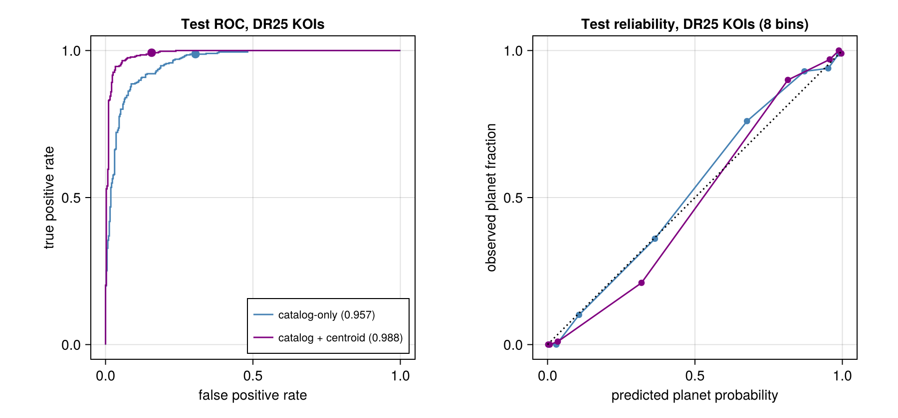

# Exoplanet vetting with machine learning (Kepler KOIs)

An independent project: a classifier that separates real transiting planets from false positives among the
~9,200 Kepler Objects of Interest (KOIs), written in Julia (Flux.jl, EvoTrees.jl). The emphasis is on an honest
evaluation: star-grouped splits, a repeated cross-validation protocol with a measured noise floor, and a test set
that was sealed until the models were frozen and then scored exactly once.

**Task.** Label = planet (CONFIRMED or CANDIDATE) vs FALSE POSITIVE, from the NASA Exoplanet Archive cumulative
KOI table. 9,201 KOIs on 7,927 stars (4,619 planets, 4,582 false positives). The robovetter's outputs
(`koi_score`, the false-positive flags, dispositions and comments) are **never** model inputs; they appear only as a
reference.

## Phase 1 results: catalog features (sealed test, scored once)

Two frozen models, each a 50/50 average of a small MLP (rank-gauss inputs, 64-32, 10 seeds) and gradient-boosted
trees (EvoTrees, depth 8, 10 seeds):
- **Catalog-only:** 11 catalog features (period, duration, depth, impact, model SNR, planet radius, equilibrium
  temperature, stellar Teff / radius / log g, number of KOIs on the star).
- **Catalog + centroid:** adds 7 centroid-offset features from the Kepler data-validation reports. These are partly
  circular, since Kepler's own centroid test used the same measurements, so this family is always reported
  separately.

Test split: 913 KOIs on 792 stars (never used for training, tuning or model choice). Headline on the 796 KOIs found by
the final, uniform DR25 pipeline. 95% star-bootstrap intervals.

| DR25 KOIs (test) | ROC-AUC | Recall at the 98%-recall threshold | Precision there | FPs kept |
|---|---|---|---|---|
| Catalog-only | **0.957** [0.944, 0.970] | 0.988 | 0.771 [0.731, 0.809] | 31% |
| Catalog + centroid | **0.988** [0.982, 0.994] | 0.993 | 0.869 [0.837, 0.898] | 16% |
| Kepler robovetter `koi_score` (reference) | 0.979 | — | — | — |

- The operating point is fixed in advance on cross-validation: keep 98% of planets, then see how many false
  positives survive. At that threshold neither model lost a single DR25 CONFIRMED planet in the test set.
- Every cross-validation estimate (5 fold shuffles × 10 seeds) lies inside its test interval (CV 0.954 / 0.983).
- The catalog + centroid model out-ranks the robovetter's `koi_score` on these KOIs, although the robovetter looks
  at the full light curves and pixel data. The comparison is partly circular in both directions, and is
  a reference only.
- Supplemental KOIs (not re-detected by DR25; near the detection limit) are much harder: test ROC-AUC 0.72 / 0.79.



## Phase 2: learning from the light curves (in progress)

Phase 2 adds what the catalog can't see: the light curves themselves.

- **Data pipeline (done):** all 7,927 stars' long-cadence light curves (53 GB of FITS from MAST) streamed into a
  14 GB compact cache. Each light curve is quality-masked, has every KOI's transits masked, and is detrended with
  a robust sliding Tukey biweight (as in `wotan`). AstroNet-style views are then built for every KOI: global, local,
  odd/even, secondary eclipse, and in-transit centroid. Label-free QA flags are attached: few transits, depth
  mismatch with the catalog, and transit-timing scatter.
- **Phase 2a (M3):** about 10 hand-made light-curve features per KOI. Each signal is measured as a significance
  against the empirical noise in one-duration boxes away from the transit:
  - our transit SNR;
  - from a trapezoid fit: V-shape, duration ratio, and depth ratio vs the catalog;
  - odd/even depth difference;
  - secondary-eclipse significance, depth ratio and phase;
  - single-event dominance;
  - timing scatter;
  - number of observed transits;
  - for the "+ centroid" family, our own centroid-shift significance.

  Same models and folds as Phase 1, so every comparison is paired (CV only; the test set is reserved for one final
  Phase 2 scoring):

| CV ROC-AUC, 7,199 DR25 KOIs (MLP + trees average, 5 × 10) | Phase 1 | + light-curve features | Paired Δ [95% CI] |
|---|---|---|---|
| Catalog family | 0.955 | **0.971** | +0.015 [+0.012, +0.018] |
| Catalog + centroid family | 0.983 | **0.987** | +0.004 [+0.003, +0.005] |

  Every single learner also improves on its own, with CIs clear of zero. Using only our own light-curve measurements,
  the catalog family now matches the robovetter `koi_score` on the pool's DR25 KOIs (0.970).

- **Next:** a small 1D CNN on the views (Phase 2b), an ensemble with Phase 2a, calibration, and one final test
  scoring next to the Phase 1 numbers.

## Repository layout

| Path | Contents |
|---|---|
| `src/VettingSetup.jl` | Shared setup: data loading, leakage guard, star-grouped split, preprocessing, MLP, metrics |
| `src/CrossValidation.jl` | Star-grouped repeated CV, out-of-fold predictions, paired star-bootstrap comparisons |
| `src/Baselines.jl`, `Centroids.jl`, `Calibration.jl`, `ErrorAnalysis.jl` | Trees, centroid features, operating points, error analysis |
| `src/LightCurves.jl`, `Detrend.jl`, `Views.jl`, `LCFeatures.jl` | Phase 2: MAST download + cache, detrending, views, light-curve features |
| `sweeps/*.jl` | Scripts that run each experiment (resumable) |
| `sweeps/results/` | CV results (out-of-fold predictions), QA and feature tables, test tables |
| `sweeps/REPORT.md` | The full write-up, step by step |
| `notebooks/` | Dated notebooks (`exoMMDDYY.ipynb`) with plots; index in `notebooks/README.md` |
| `ExoOnboarding.ipynb` | Introduction: data, physics, method, results |
| `PHASE2_PLAN.md` | Phase 2 design and milestones |
| `models/step5_frozen.jld2` | The two frozen Phase 1 models |
| `data/koi_cumulative.csv` | NASA Exoplanet Archive cumulative KOI table (as downloaded) |

## Reproducing

Requires Julia 1.12 (developed with 1.12.6). From the repository root:

```
julia --project=. -e "import Pkg; Pkg.instantiate()"
julia --project=. -t auto sweeps/cv_baselines.jl      # Phase 1 CV examples; see sweeps/REPORT.md for each step
```

- Notebooks load everything with `include(joinpath(@__DIR__, "..", "src", "VettingSetup.jl"))`.
- Phase 2 needs the light curves: `sweeps/p2_download.jl` (~55 GB streamed from MAST, ~2.5 h, kept as a ~14 GB
  cache under `data/lightcurves/`, not in git). Then run `sweeps/p2_build.jl` (views + QA, ~1.5 h),
  `sweeps/p2_features.jl` and `sweeps/p2_cv.jl`.
- The sealed-test script (`sweeps/step5_test.jl`) is kept for the record; it refuses to run a second time.

## Data and credits

- KOI table: NASA Exoplanet Archive, Kepler cumulative KOI table.
- Light curves: Kepler DR25 long-cadence data, from MAST (STScI).
- Methods follow Shallue & Vanderburg (2018, AstroNet) for the views and Hippke et al. (2019, `wotan`) for
  detrending.
