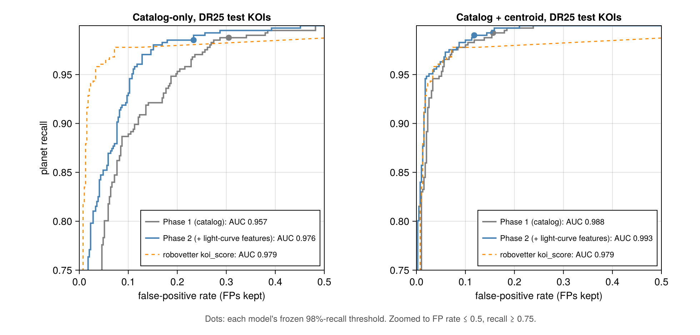

# Exoplanet vetting with machine learning (Kepler KOIs)

An independent project: a classifier that separates real transiting planets from false positives among the
~9,200 Kepler Objects of Interest (KOIs), written in Julia (Flux.jl, EvoTrees.jl). The emphasis is on an honest
evaluation: star-grouped splits, a repeated cross-validation protocol with a measured noise floor, and a test set
that stays sealed until the models are frozen and is then scored once per phase (once for Phase 1, once for
Phase 2). Phase 1 uses catalog numbers only; Phase 2 adds features measured from the Kepler light curves.

**Task.** Label = planet (CONFIRMED or CANDIDATE) vs FALSE POSITIVE, from the NASA Exoplanet Archive cumulative
KOI table. 9,201 KOIs on 7,927 stars (4,619 planets, 4,582 false positives). The robovetter's outputs
(`koi_score`, the false-positive flags, dispositions and comments) are **never** model inputs; they appear only as a
reference.

## Phase 1 results: catalog features (sealed test, scored once)

Two frozen models, each a 50/50 average of a small MLP (rank-gauss inputs, 64-32, 10 seeds) and gradient-boosted
trees (EvoTrees, depth 8, 10 seeds):
- **Catalog-only:** 11 catalog features (period, duration, depth, impact, model SNR, planet radius, equilibrium
  temperature, stellar Teff / radius / log g, number of KOIs on the star).
- **Catalog + centroid:** adds 7 centroid-offset features from the Kepler data-validation reports. These are partly
  circular, since Kepler's own centroid test used the same measurements, so this family is always reported
  separately.

Test split: 913 KOIs on 792 stars (never used for training, tuning or model choice). Headline on the 796 KOIs found by
the final, uniform DR25 pipeline. 95% star-bootstrap intervals.

| DR25 KOIs (test) | ROC-AUC | Recall at the 98%-recall threshold | Precision there | FPs kept |
|---|---|---|---|---|
| Catalog-only | **0.957** [0.944, 0.970] | 0.988 | 0.771 [0.731, 0.809] | 31% |
| Catalog + centroid | **0.988** [0.982, 0.994] | 0.993 | 0.869 [0.837, 0.898] | 16% |
| Kepler robovetter `koi_score` (reference) | 0.979 | — | — | — |

- The operating point is fixed in advance on cross-validation: keep 98% of planets, then see how many false
  positives survive. At that threshold neither model lost a single DR25 CONFIRMED planet in the test set.
- Every cross-validation estimate (5 fold shuffles × 10 seeds) lies inside its test interval (CV 0.954 / 0.983).
- The catalog + centroid model out-ranks the robovetter's `koi_score` on these KOIs, although the robovetter looks
  at the full light curves and pixel data. The comparison is partly circular in both directions, and is
  a reference only.
- Supplemental KOIs (not re-detected by DR25; near the detection limit) are much harder: test ROC-AUC 0.72 / 0.79.


## Phase 2 results: adding the light curves (sealed test, scored once)

Phase 2 adds what the catalog can't see: the light curves themselves. The final models keep Phase 1's recipe (MLP +
trees, 50/50) and add 11 light-curve features that we measure ourselves (plus 2 of our own centroid features in the
"+ centroid" family). They were frozen on cross-validation alone and then scored once on **the same sealed test
split** as Phase 1, so the two phases are compared on identical KOIs. The Phase 1 numbers had been seen, but no
Phase 2 choice was tuned on the test set.

| DR25 KOIs (test, 796) | Phase 2 ROC-AUC | Phase 1 | Paired Δ [95% CI] | Precision at 98% recall | FPs kept |
|---|---|---|---|---|---|
| Catalog-only | **0.976** [0.966, 0.984] | 0.957 | +0.018 [+0.011, +0.027] | 0.815 (Phase 1: 0.771) | **23%** (31%) |
| Catalog + centroid | **0.993** [0.988, 0.996] | 0.988 | +0.004 [+0.001, +0.009] | 0.897 (Phase 1: 0.869) | **12%** (16%) |
| Kepler robovetter `koi_score` (reference) | 0.979 | | | | |

- **The light curves help in both families, and the test confirms cross-validation** (CV expected 0.970 / 0.987,
  inside the test intervals). Paired Δ: star bootstrap of the AUC difference on the same test KOIs.
- **At the 98% planet-recall threshold** (fixed in advance on CV), the catalog-only model passes a quarter fewer
  false positives than in Phase 1. Test recall is 0.985 / 0.990, and at most 0.4% of DR25 CONFIRMED planets are lost.
- **Catalog-only now comes close to the robovetter** (0.976 vs 0.979) using only catalog numbers and our own
  light-curve measurements. The robovetter is still better at very low false-positive rates (left panel).
- **Supplemental KOIs** (117 in the test) improve to 0.760 / 0.797 (Phase 1: 0.724 / 0.788), but the test is too
  small to call that difference.
- **Calibration:** none needed; on DR25 KOIs the scores read as planet probabilities (CV expected calibration
  error 0.012).



### How Phase 2 works

- **Data pipeline:** all 7,927 stars' long-cadence light curves (53 GB of FITS from MAST) streamed into a
  14 GB compact cache. Each light curve is quality-masked, has every KOI's transits masked, and is detrended with
  a robust sliding Tukey biweight (as in `wotan`). AstroNet-style views are then built for every KOI: global, local,
  odd/even, secondary eclipse, and in-transit centroid. Label-free QA flags are attached: few transits, depth
  mismatch with the catalog, and transit-timing scatter.
- **Phase 2a, the final model:** 11 hand-made light-curve features per KOI. Each signal is measured as a significance
  against the empirical noise in one-duration boxes away from the transit:
  - our transit SNR;
  - from a trapezoid fit: V-shape, duration ratio, and depth ratio vs the catalog;
  - odd/even depth difference;
  - secondary-eclipse significance, depth ratio and phase;
  - single-event dominance;
  - timing scatter;
  - number of observed transits;
  - for the "+ centroid" family, our own centroid-shift significance.

  Same models and folds as Phase 1, so every comparison is paired. Cross-validation, 5 fold shuffles × 10 seeds:

| CV ROC-AUC, 7,199 DR25 KOIs (MLP + trees average) | Phase 1 | + light-curve features | Paired Δ [95% CI] |
|---|---|---|---|
| Catalog family | 0.955 | **0.971** | +0.015 [+0.012, +0.018] |
| Catalog + centroid family | 0.983 | **0.987** | +0.004 [+0.003, +0.005] |

  Every single learner also improves on its own, with CIs clear of zero.

- **Phase 2b, a CNN on the views (tried, not used):** a small AstroNet-style two-tower 1D CNN (~180k parameters,
  CPU-trained), on the views alone or joined with the tabular features. Five variants, on the same folds:
  - From the views alone it reaches CV 0.949 on DR25 KOIs, about Phase 1's level, so the views carry real signal.
  - Every variant scores below the Phase 2a model (best: −0.004 [−0.005, −0.003]).
  - None improves it in a 50/50 ensemble (Δ −0.001 to −0.002, CIs at or below 0).
  - The hand-made features already capture what this small CNN learns from the views, so Phase 2a is the final model.

- **What is still hard:** "not transit-like" and contamination false positives. Their miss rates fall (for example
  27% → 24% and 26% → 23% in the "+ centroid" family, CV, threshold 0.5) but stay the largest error groups.
  Ultra-short-period planets wrongly rejected fall from 60% to 40% in the catalog family.

## Repository layout

| Path | Contents |
|---|---|
| `src/VettingSetup.jl` | Shared setup: data loading, leakage guard, star-grouped split, preprocessing, MLP, metrics |
| `src/CrossValidation.jl` | Star-grouped repeated CV, out-of-fold predictions, paired star-bootstrap comparisons |
| `src/Baselines.jl`, `Centroids.jl`, `Calibration.jl`, `ErrorAnalysis.jl` | Trees, centroid features, operating points, error analysis |
| `src/LightCurves.jl`, `Detrend.jl`, `Views.jl`, `LCFeatures.jl`, `CNN.jl` | Phase 2: MAST download + cache, detrending, views, light-curve features, CNN |
| `sweeps/*.jl` | Scripts that run each experiment (resumable) |
| `sweeps/results/` | CV results (out-of-fold predictions), QA and feature tables, test tables |
| `sweeps/REPORT.md` | The full write-up, step by step |
| `notebooks/` | Dated notebooks (`exoMMDDYY.ipynb`) with plots; index in `notebooks/README.md` |
| `ExoOnboarding.ipynb` | Introduction: data, physics, method, results |
| `PHASE2_PLAN.md` | Phase 2 design and milestones |
| `models/step5_frozen.jld2`, `models/p2_frozen.jld2` | The frozen Phase 1 and Phase 2 models (two families each) |
| `data/koi_cumulative.csv` | NASA Exoplanet Archive cumulative KOI table (as downloaded) |

## Reproducing

Requires Julia 1.12 (developed with 1.12.6). From the repository root:

```
julia --project=. -e "import Pkg; Pkg.instantiate()"
julia --project=. -t auto sweeps/cv_baselines.jl      # Phase 1 CV examples; see sweeps/REPORT.md for each step
```

- Notebooks load everything with `include(joinpath(@__DIR__, "..", "src", "VettingSetup.jl"))`.
- Phase 2 needs the light curves: `sweeps/p2_download.jl` (~55 GB streamed from MAST, ~2.5 h, kept as a ~14 GB
  cache under `data/lightcurves/`, not in git). Then run `sweeps/p2_build.jl` (views + QA, ~1.5 h),
  `sweeps/p2_features.jl`, `sweeps/p2_cv.jl`, `sweeps/p2_cnn.jl` (CNN; slow on a CPU) and `sweeps/p2_m5.jl`
  (calibration, operating points, freeze).
- The sealed-test scripts (`sweeps/step5_test.jl`, `sweeps/p2_test.jl`) are kept for the record; each refuses to
  score the test set a second time.

## Data and credits

- KOI table: NASA Exoplanet Archive, Kepler cumulative KOI table.
- Light curves: Kepler DR25 long-cadence data, from MAST (STScI).
- Methods follow Shallue & Vanderburg (2018, AstroNet) for the views and Hippke et al. (2019, `wotan`) for
  detrending.
